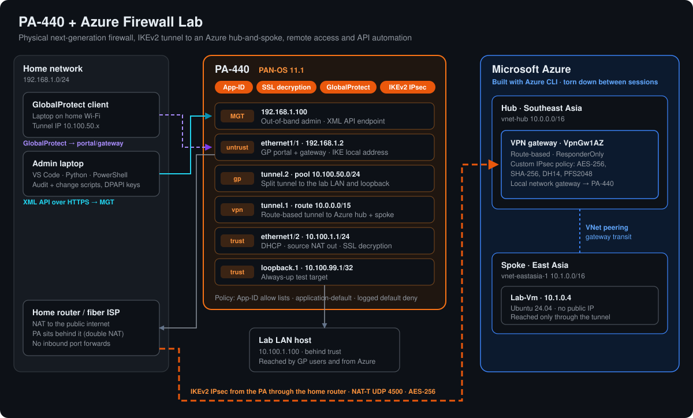

# Palo Alto PA-440 Firewall Lab

Hands-on lab built on a physical **PA-440 (PAN-OS 11.1)** with an **Azure** hub, covering the work firewall engineering roles ask for: App-ID policy, NAT, SSL decryption, site-to-site IPsec, GlobalProtect remote access, and API automation in Python. Each lab includes the build, validation, deliberate break-and-fix tests, and the real log evidence.

## Labs

| # | Lab | Skills |
| --- | --- | --- |
| 1 | [Firewall baseline and App-ID](docs/01-firewall-baseline.md) | Zones, DHCP, source NAT, routing, App-ID policy from default deny |
| 2 | [SSL forward proxy decryption](docs/02-ssl-decryption.md) | Forward trust/untrust CAs, decryption profiles, exclusions, certificate validation |
| 3 | [Site-to-site VPN to Azure](docs/03-azure-site-to-site-vpn.md) | IKEv2, NAT-T behind NAT, route-based tunnel, Phase 1 / Phase 2 troubleshooting |
| 4 | [GlobalProtect remote access](docs/04-globalprotect.md) | Portal and gateway, certificates, split tunnel, local auth |
| 5 | [PAN-OS XML API automation](docs/05-api-automation.md) | Read-only rule audit, scripted change with partial commit, key handling |

## Architecture



## Automation in this repo

```text
pan_audit.py      read-only audit of the security rulebase -> CSV
push_change.py    create/remove an address object and commit (dry run by default, partial commit)
bootstrap-writer.ps1  creates the change account itself via the API (one-time admin login, plan + confirm)
setup.ps1         one-time setup; stores API keys encrypted with Windows DPAPI
run-audit.ps1     runs the audit with the stored read-only key
run-push.ps1      runs push_change.py with the stored writer key
publish.ps1       commits and pushes this repo after checking no secrets are tracked
```

In VS Code: **Ctrl+Shift+B** runs the audit; **Terminal > Run Task** lists the rest.

## Security notes

- API accounts use least-privilege admin roles; the audit account has no commit or Web UI access.
- Keys are stored encrypted per Windows user and never committed (`.secrets/` is git-ignored).
- Public IP addresses are redacted from the write-ups.
