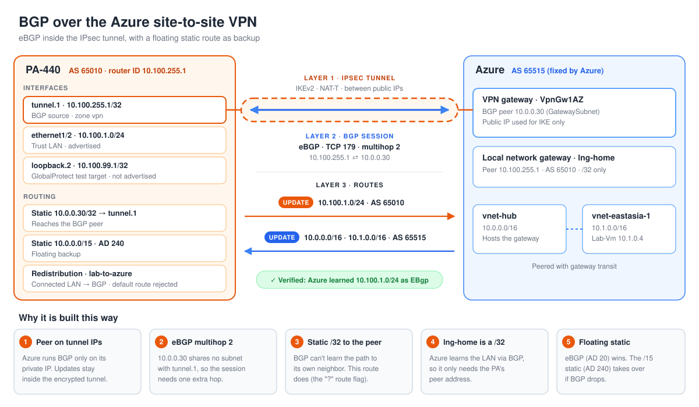
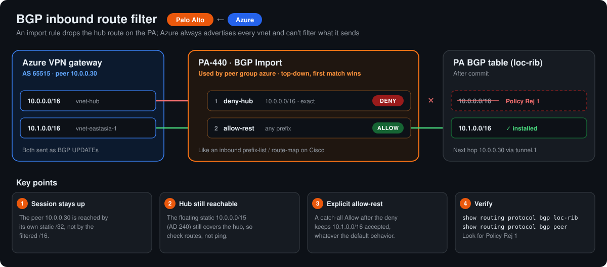

# Lab 6: BGP over the Azure site-to-site VPN

**Goal:** replace the static route to Azure with eBGP running inside the IPsec tunnel from Lab 3, keep the static route as a floating backup, then break and fix the session on purpose.



## Design

| Item | Value |
| --- | --- |
| PA | AS 65010, router ID and BGP source `10.100.255.1/32` on tunnel.1 |
| Azure | VPN gateway, AS 65515 (fixed by Azure), BGP peer `10.0.0.30` in GatewaySubnet |
| Peer reachability | Static `10.0.0.30/32` via tunnel.1 (BGP can't learn the route to its own neighbor) |
| Session | eBGP, TCP 179, multihop 2, default route rejected |
| Advertised | Connected `10.100.1.0/24` via redistribution profile `lab-to-azure` (origin incomplete) |
| Learned | `10.0.0.0/16` (hub) and `10.1.0.0/16` (spoke, via gateway transit) |
| Backup | Static `10.0.0.0/15` raised to admin distance 240 (floating) |
| Azure local network gateway | BGP enabled, peer `10.100.255.1`, address space shrunk to `10.100.255.1/32` |

## Build notes

- The peer address must be a bare IP. An address object named with `/32` broke the peer config.
- The redistribution profile's interface filter on `ethernet1/2` only works while the link is up: with the cable out there is no connected route, so nothing is advertised. A host `/32` such as a loopback shows as `H` (host), not `C` (connected), so the connected filter does not pick it up.
- The learned routes show the `?` flag (`A?B`): their next hop `10.0.0.30` is resolved recursively through the static `/32`.

## Validation

```text
show routing protocol bgp summary
  peer azure-gw:  AS 65515, Established, IP 10.0.0.30
  bgpAfiIpv4/unicast pfx:  Accepted pfx: 2, Advertised pfx: 1

az network vnet-gateway list-learned-routes -o table
Network          NextHop       Origin    SourcePeer    AsPath
10.100.1.0/24    10.100.255.1  EBgp      10.100.255.1  65010
```

`test routing fib-lookup virtual-router default ip 10.1.0.4` resolves to tunnel.1, and the learned `/16` routes (AD 20) win over the floating `/15` static (AD 240).

## Break-and-fix tests

### 1. Wrong peer AS

Changed the peer AS from 65515 to 65516.

```text
Last error:   error in OPEN message (2) : AS unacceptable (2)
Flap counts:  95, established 0 times
```

Notification code 2 / subcode 2 is *bad peer AS*. The tunnel stayed up, but BGP dropped, Azure lost `10.100.1.0/24`, and pings failed. The floating static only covers the PA side: with the local network gateway at `/32`, Azure had no return route. Fixed by restoring 65515.

### 2. Multihop removed

Set multihop to 0 (TTL 1). The session re-established and stayed up:

```text
Peer status:     Established, for 403 seconds
Multi-hop TTL:   1
Flap counts:     1, established 1 times
```

The far end of tunnel.1 is the Azure gateway, and the gateway itself is the BGP speaker at `10.0.0.30`, so the packet travels one hop and TTL 1 is enough. PAN-OS also did not refuse to peer with a neighbor outside its connected subnets, unlike a Cisco router's eBGP connected check. Multihop is needed when the peer sits past the gateway (Azure Route Server, a router or firewall VM in the VNet). Kept at 2 as a safety margin.

### 3. Inbound route filter

Azure always advertises every VNet it can reach, so filtering happens on the PA with BGP import rules: `deny-hub` (exact `10.0.0.0/16`, deny) followed by `allow-rest` (any, allow).



```text
show routing protocol bgp loc-rib
  Prefix             Nexthop          Peer       Org   AS-Path
 *10.1.0.0/16        10.0.0.30        azure-gw   igp   65515
 *10.100.1.0/24                       Local      i/c
```

The session stayed up because the peer is reached by its own static `/32`. Hub traffic still worked over the floating `/15`, so the filter shows in the route table, not in a ping test. Removed both rules afterwards.

## Takeaways

- Troubleshoot in layers: tunnel, then BGP session state, then advertised and accepted prefix counts.
- `Last error` in `show routing protocol bgp peer` names the failure; code 2 / subcode 2 is an AS mismatch.
- A floating static protects one direction only; the other side needs its own path back.
- With route-based VPN to the Azure gateway, the BGP peer is one hop away; multihop matters when peering past it.
